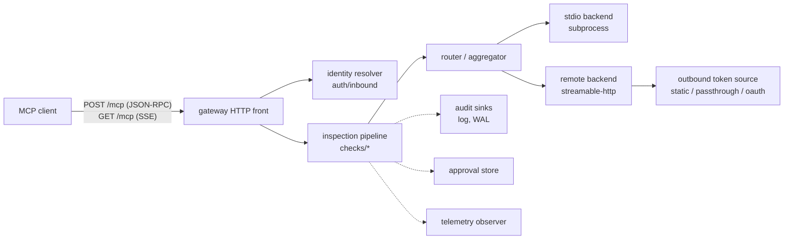

# Architecture overview

mcpproxy is an MCP gateway: a single HTTP front that terminates the MCP
streamable-HTTP protocol, inspects every JSON-RPC message in both
directions, and bridges to one or more MCP servers.

## Message flow

One client POST = one JSON-RPC message:

1. **Identity** — the resolver authenticates the request (OIDC, static
   token, GitHub, AWS STS, or the embedded auth server's own JWTs).
   `initialize` creates a session (`Mcp-Session-Id` response header);
   every later message must carry that header.
2. **Routing resolution** — for `tools/call` under aggregation, the
   `<backend>_` prefix picks the backend and is stripped, so checks see the
   real backend + bare tool name.
3. **C2S pipeline** — the message runs through the check chain. Outcomes:
   forward (possibly mutated), deny (synthesized JSON-RPC error, session
   lives), hold (parked for human approval), or kill (session torn down).
4. **Round-trip** — the message goes to the backend; the response is
   correlated by JSON-RPC id.
5. **S2C pipeline** — the response runs through the chain too (catalog
   filtering, rug-pull fingerprinting, redaction, truncation) before
   returning to the client.
6. **Server-initiated traffic** (notifications, `sampling/createMessage`,
   `elicitation/create`) arrives on the backend pump, passes the S2C
   pipeline (server→LLM requests are denied by default), and is delivered
   over the session's SSE stream (`GET /mcp`).

## Sessions

- A session = one client conversation = one live connection to EVERY
  configured backend. `initialize` fans out to all backends; stdio
  backends spawn a child per session, killed (whole process group) at
  session end.
- Backend lifetime is deliberately decoupled from the HTTP request context
  (`context.WithoutCancel`): the initialize POST returning must not kill
  the child that was just spawned.
- Sessions end on `DELETE /mcp`, backend death, a kill verdict, or the
  idle reaper (default 30 min).

## Aggregation

More than one backend turns the gateway into a virtual MCP:

- `tools/list` fans out and merges; each tool is prefixed `<backend>_`.
- `tools/call` routes by prefix; the backend sees its original tool name.
- `initialize` reports a gateway-branded `serverInfo`.
- Policy can differ per backend (`backends.<name>.policy` overrides the
  global policy field-by-field).

## Package map

| Package | Role |
|---|---|
| `jsonrpc` | tolerant JSON-RPC 2.0 envelope: parses the five standard fields, preserves everything else byte-for-byte |
| `mcp` | MCP method names + payload subsets the gateway inspects |
| `gateway` | HTTP front, session lifecycle, pumps, routing, aggregation |
| `session` | per-session state: id→request correlation, tool fingerprints, counters, check scratch space |
| `inspect` | pipeline contracts: `Check`, `Msg`, `Decision`, `Hooks`, `Session` |
| `checks` | the security checks (policy, approval, s2c-gate, rug-pull, overrides, budget, guardrails, redact, audit-tap) |
| `backend` | `Backend` interface + stdio and streamable-http implementations |
| `auth/inbound` | caller authentication (OIDC/static/local/anonymous/GitHub/AWS STS) |
| `auth/outbound` | backend credentials: token sources, encrypted stores; `oauth/` adds discovery, DCR, PKCE, refresh, RFC 8693 |
| `auth/authserver` | embedded OAuth 2.1 authorization server with upstream IdP federation |
| `approval` | held-call store + REST resolution API |
| `audit` | event vocabulary + sink fan-out |
| `wal` | per-session JSONL recording / replay |
| `telemetry` | Prometheus + OTLP observer |
| `optimizer` | top-K semantic tool filtering |
| `config` | YAML schema + validation |
| `cmd/mcpproxyd` | the daemon: wires everything above |
| `cmd/mcpsmoke` | scripted MCP client for smoke tests |
| `cmd/configcheck` | config validation without starting the daemon |

## Design decisions

**Tolerant protocol handling.** The gateway parses only what it inspects;
unknown fields, methods, and capabilities pass through untouched. MCP
revisions ship frequently — strict validation would turn every spec bump
into an outage.

**Messages, not byte streams.** Inspection happens per JSON-RPC message
(including per SSE event), never on opaque HTTP bodies. That is what makes
tool-level policy, catalog rewriting, and structured audit possible.

**Deny ≠ kill.** A blocked tool call answers with a JSON-RPC error the
model can read and explain; the session survives. Killing is reserved for
integrity violations (rug pull, poisoned catalog).

**Catalog filtering over call blocking.** A denied tool is removed from
`tools/list` before the model sees it — a tool the model cannot see is a
tool it never attempts. Call-time checks remain as the backstop.

**Sessions own subprocesses.** One stdio child per session, process-group
killed on teardown. No sharing: MCP servers are stateful after
`initialize`, and isolation makes cleanup trivial.

**Seams over dependencies.** Guardrails, masking, AI analysis, approvals,
audit, telemetry, and identity are all interfaces (`inspect.Hooks`,
`gateway.HeldStore`, `audit.Sink`, …). The daemon wires standalone
implementations; an embedding host (hoop) swaps in its own without touching
gateway code.
